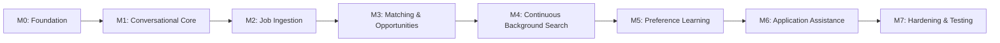

# HeeraMon: Development Plan & Roadmap

## 1. Project Overview & Philosophy

**HeeraMon** is an AI-powered personal job-seeking assistant and career advisor, inspired by the mythical wisdom bird (*HeeraMon*) that advises its owner before crucial life decisions.

Unlike conventional job boards focused on keyword search or mass-application bots that spam employers, HeeraMon is built around:
1. **Conversation over Configuration**: Expressing requirements in natural language (e.g., *"At least 40k BDT, AI/ML role, maximum 30-minute commute, 7 hours/day, friendly culture"*).
2. **Fit over Volume**: Prioritizing genuine suitability and lifestyle harmony over sheer count of vacancies.
3. **Continuous Assistance**: Specifying goals once, allowing the assistant to persistently seek, evaluate, and alert.
4. **Wisdom & Transparent Trade-offs**: Clear explanations of pros, cons, and compromises instead of black-box match numbers.
5. **Human Control Over Consequential Actions**: Explicit user approval required before any real-world application submission.
6. **LLM-Assisted, Not LLM-Dependent**: Deterministic engines handle filtering, deduplication, scheduling, and validation; LLMs handle semantic reasoning, preference extraction, trade-offs, and conversational nuance.

---

## 2. Architecture & Technology Stack

### Backend
- **Framework**: Python 3.13 + FastAPI for high-performance async REST & streaming endpoints.
- **Database / ORM**: SQLAlchemy 2.0 (async/sync) with Pydantic v2 schemas.
  - Zero-friction local development default: SQLite with foreign keys and WAL mode.
  - Production ready: Seamless configuration switch to PostgreSQL / Supabase via standard DB URI.
- **LLM Provider Abstraction**:
  - Unified interface: `BaseLLMProvider` supporting Google Gemini, OpenAI-compatible APIs, and an intelligent **Deterministic / Mock Heuristic Provider** (guaranteeing offline usability, deterministic testability, and zero API costs during standard development).
- **Scheduler**: Async background runner (APScheduler / asyncio tasks) for automated ingestion, matching, and notifications.

### Frontend
- **Framework**: Next.js 14/15 (React 18/19, TypeScript).
- **Styling**: Tailwind CSS with custom minimalistic, calm aesthetic (pure whites, slate/charcoal typography, subtle borders, warm accents).
- **Icons & Motion**: Lucide React + Framer Motion for subtle, purposeful bird interactions and smooth transitions.
- **Assets**: Authentic HeeraMon bird avatars integrated from `Assets/Logo/`.

---

## 3. Milestones & Implementation Phases

### Phase 0: Project Foundation (Milestone 0)
- [ ] Initialize backend repository structure (`backend/`):
  - FastAPI app factory, CORS configuration, API router `/api/v1`.
  - Database configuration & SQLAlchemy models: `User`, `Preference`, `Conversation`, `Message`, `Job`, `JobSource`, `JobSourceRecord`, `Match`, `UserDecision`, `Application`, `Notification`, `AgentRun`.
  - Service container and configuration management (`config.py`).
- [ ] Initialize frontend repository structure (`frontend/`):
  - Next.js TypeScript app, Tailwind setup, layout shell.
  - Copy and configure logo assets from `Assets/Logo/`.
  - Client API service layer connecting to FastAPI backend.
- [ ] Implement end-to-end health check and verification script.

### Phase 1: Conversational Core & Preference Engine (Milestone 1)
- [ ] Backend Conversation & Agent Engine:
  - LLM Provider Abstraction (`GeminiProvider`, `MockProvider`).
  - Preference Extraction Engine: parses raw messages into categories (`salary`, `role`, `location`, `work_mode`, `hours`, `culture`, `benefits`).
  - Preference classification: `Hard` constraint vs `Soft` preference vs `Learned` vs `Unknown`.
  - Clarification loop: prompts the user when ambiguity affects decision making.
- [ ] Frontend Conversational Interface:
  - Calm chat window with HeeraMon bird companion avatar and state-driven reactions (idle, listening, thinking, advising).
  - Suggestion chips, real-time message streaming / optimistic updates.
  - Interactive Preference Panel: shows real-time understood preferences, confidence, and allows manual edit/delete/confirm.

### Phase 2: Job Ingestion & Normalization (Milestone 2)
- [ ] Multi-source Adapter Pattern:
  - Base `JobSourceAdapter` interface (`fetch_jobs()`, `normalize_job()`).
  - Adapters: RemoteOK / Jobicy / Arbeitnow public APIs + curated local/regional tech job feeds.
  - Robust error handling: source failure isolation (one source failing does not halt ingestion).
- [ ] Deduplication & Storage Engine:
  - Content fingerprinting (normalized title + company + location hash).
  - Upsert mechanism linking `Job` and `JobSourceRecord` tracking `first_seen_at` and `last_seen_at`.
  - CLI / API endpoint to trigger on-demand ingestion.

### Phase 3: Matching Engine & Opportunity Exploration (Milestone 3)
- [ ] Deterministic & Semantic Matching Layer:
  - **Stage 1**: Eligibility check against explicit hard requirements (e.g. minimum salary, work arrangement, must-have tech).
  - **Stage 2**: Soft preference scoring (commute, flexible hours, team culture, perks).
  - **Stage 3**: Trade-off analysis generator (e.g., *"Salary is 15% higher than requested, but commute is 45 min instead of 30 min"*).
  - **Stage 4**: Match explanation synthesizer: structured output detailing satisfied, violated, and unknown factors.
- [ ] Frontend Opportunities & Job Detail View:
  - Opportunity cards with visual fit indicators (Fit breakdown, Trade-offs badge).
  - Expandable job detail view with transparent reasoning breakdown.
  - Decision buttons: `Interested`, `Save`, `Decline`, `Proceed to Apply`.

### Phase 4: Continuous Background Search & Notification Hub (Milestone 4)
- [ ] Background Scheduling Service:
  - Periodic background ingestion and matching loop.
  - Match delta detection (only alerting for new high-relevance opportunities).
  - Notification generator with deduplication logic.
- [ ] Frontend Notification Center:
  - Notification drawer / bell indicator in navigation.
  - Configurable search cadence (e.g., Immediate, Daily Digest, Hourly, Paused).

### Phase 5: Preference Learning & Conversational Memory (Milestone 5)
- [ ] Decision Intelligence:
  - Track user decisions (`interested`, `declined`, `applied`) with optional feedback reasons.
  - Behavioral pattern detection (e.g., user rejected 3 jobs with salary < 45k).
  - Conversational confirmation prompts: *"You've rejected several roles under 45k. Would you like me to make 45k your minimum requirement?"*
  - Persistent preference history log.

### Phase 6: Application Assistance & Human Approval (Milestone 6)
- [ ] Application Preparation Workflow:
  - Extract and tailor user profile / CV highlights specifically for the selected job.
  - Cover letter / introductory note generation aligned with candidate's actual background (strictly strictly avoiding hallucinations or invented facts).
  - Application checklist & validation.
- [ ] Human-in-the-Loop Approval Boundary:
  - Application review screen: displays all tailored answers, resume links, and questions.
  - Explicit confirmation step (`Approve & Mark Ready` / `Export Package`).
  - Application status tracking (`Draft` -> `Under Review` -> `Approved` -> `Submitted`).

### Phase 7: Polish, Testing & Deployment Readiness (Milestone 7)
- [ ] Unit & Integration test suites:
  - Test preference extraction with sample conversations.
  - Test deterministic matching & trade-off edge cases.
  - Test ingestion deduplication and error recovery.
- [ ] UI/UX Polish:
  - Responsive layout (mobile & desktop).
  - Accessibility (ARIA labels, keyboard navigation).
  - Empty, loading, and error states across all views.
- [ ] Documentation & Run instructions (`README.md`, setup scripts).

---

## 4. Execution Strategy & Token Optimization

- **Fast & Isolated Iterations**: Build the backend foundation and core deterministic modules first with unit verification scripts, then build the frontend interface.
- **Avoid Heavy Blockers**: Avoid fragile local system dependencies (use lightweight SQLite by default with standard SQLAlchemy models so it's 100% Postgres compatible; avoid complex heavy C++ dependencies).
- **Mock/Offline Capability**: Ensure system runs completely without external API keys in developer mode, with instant plug-and-play support for real LLM keys (Gemini / OpenAI).
- **Direct, Concise Output**: Keep intermediate token output focused and task-oriented.
